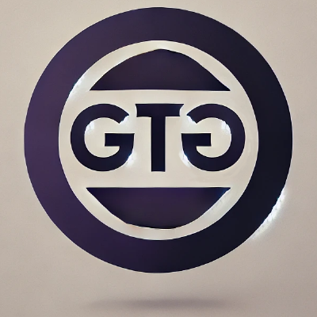

  

<h1 align="center">Gotigin</h1>

<strong>Where Technology Meets Discovery</strong>

  Company house mark of <strong>GOTIGIN SOFTWARE &amp; HARDWARE PRIVATE LIMITED</strong> 
  <a href="https://gotigin.com">gotigin.com</a>
  ·
  <a href="https://gotigin.com/privacy">Privacy</a>
  ·
  <a href="https://gotigin.com/help">Help</a>
  ·
  <a href="https://gotigin.com/about">About</a>

---

## Brands

| Brand | What it is | Site / repos |
| --- | --- | --- |
| **Kumkaj** | Business operating systems — Khaynjo, Moklanjo, Kirano, Tabiyat | [kumkaj.com](https://kumkaj.com) · [`gotigin/kumkaj`](https://github.com/gotigin/kumkaj) |
| **Wadhu** | Reusable tools — SMS Gateway, Wadhu Connect | [wadhu.com](https://wadhu.com) · [`gotigin/wadhu`](https://github.com/gotigin/wadhu) |
| **Ghal Bol** | Communication products — encrypted messenger | [ghalbol.com](https://ghalbol.com) · [`gotigin/ghalbol`](https://github.com/gotigin/ghalbol) |

## Public repos

| Repo | Role |
| --- | --- |
| [`domain`](https://github.com/gotigin/domain) | Company website and legal pages for **gotigin.com** |
| [`kumkaj`](https://github.com/gotigin/kumkaj) | Kumkaj BOS apps (Makepad 2) |
| [`wadhu`](https://github.com/gotigin/wadhu) | Wadhu tools, SMS Gateway, Connect |
| [`ghalbol`](https://github.com/gotigin/ghalbol) | Ghal Bol communication products |

## Company

**GOTIGIN SOFTWARE & HARDWARE PRIVATE LIMITED**  
Rajkot, Gujarat, India · [mearaj@gotigin.com](mailto:mearaj@gotigin.com)

Trademark / house mark: **Gotigin** (GTG).  
Product brands keep their own domains and privacy policies; company verifiers use [gotigin.com](https://gotigin.com).
