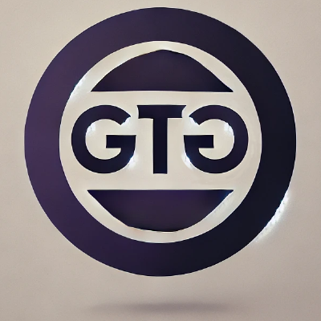

  

<h1 align="center">Gotigin</h1>

<strong>Where Technology Meets Discovery</strong>

Memon for <em>find it</em> · go-tee-geen

  Trademark of <strong>GOTIGIN SOFTWARE &amp; HARDWARE PRIVATE LIMITED</strong> 
  <a href="https://gotigin.com">gotigin.com</a>
  ·
  <a href="https://gotigin.com/privacy">Privacy</a>
  ·
  <a href="https://gotigin.com/terms">Terms</a>
  ·
  <a href="https://gotigin.com/cancellation">Cancellation</a>
  ·
  <a href="https://gotigin.com/support">Support</a>
  ·
  <a href="https://gotigin.com/about">About</a>

---

## Brands and products

Identity order: **Gotigin** (trademark) → **GOTIGIN SOFTWARE &amp; HARDWARE PRIVATE LIMITED** (company) → brand → product.

| Brand | What it is | Site |
| --- | --- | --- |
| **Kumkaj** | Business operating systems | [kumkaj.com](https://kumkaj.com) |
| **Wadhu** | Memon *more* — Tools · Apps · More (not a messenger) | [wadhu.com](https://wadhu.com) |
| **Ghal Bol** | Encrypted messenger | [ghalbol.com](https://ghalbol.com) |

### Kumkaj products

| Product | Role | Site |
| --- | --- | --- |
| **Khaynjo** | Restaurant OS — tables, KOT, bills, day close | [khaynjo.com](https://khaynjo.com) |
| **Moklanjo** | Courier desk — booking, parties, day book | [moklanjo.com](https://moklanjo.com) |
| **Kirano** | Kirana — catalogue, stock, khata, GST cash memo | [kirano.shop](https://kirano.shop) |
| **Tabiyat** | Pharmacy counter — batch, expiry, stock, GST bills | [tabiyat.shop](https://tabiyat.shop) |

### Wadhu products

| Product | Role | Site |
| --- | --- | --- |
| **SMS Gateway** | Android-first SIM messaging | [wadhu.com](https://wadhu.com) |
| **SMS Relay** | Optional internet plane for SMS | [wadhu.com](https://wadhu.com) |
| **Wadhu Connect** | WhatsApp Cloud API bridge | [connect.wadhu.com](https://connect.wadhu.com/) |

### Ghal Bol products

| Product | Role | Site |
| --- | --- | --- |
| **Ghal Bol** | Encrypted messenger | [ghalbol.com](https://ghalbol.com) |

## Public repos

| Repo | Role |
| --- | --- |
| [`domain`](https://github.com/gotigin/domain) | Company website and legal pages for **gotigin.com** |
| [`kumkaj`](https://github.com/gotigin/kumkaj) | Kumkaj BOS apps (Makepad 2) |
| [`wadhu`](https://github.com/gotigin/wadhu) | Wadhu tools: SMS Gateway, SMS Relay, Wadhu Connect |
| [`ghalbol`](https://github.com/gotigin/ghalbol) | Ghal Bol communication products |

## Company

**GOTIGIN SOFTWARE & HARDWARE PRIVATE LIMITED**  
C/O Mearaj AB, Gosiya Manzil, Darbargadh, Dhoraji, Rajkot, Gujarat 360410, India  
CIN U62011GJ2026PTC179660 · GSTIN 24AANCG1628G1ZP  
[support@gotigin.com](mailto:support@gotigin.com)

Trademark / house mark: **Gotigin** (GTG).  
Product brands keep their own domains and privacy policies. Company pages are at [gotigin.com](https://gotigin.com).
